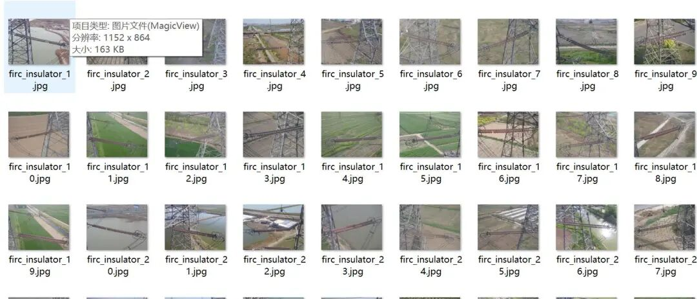
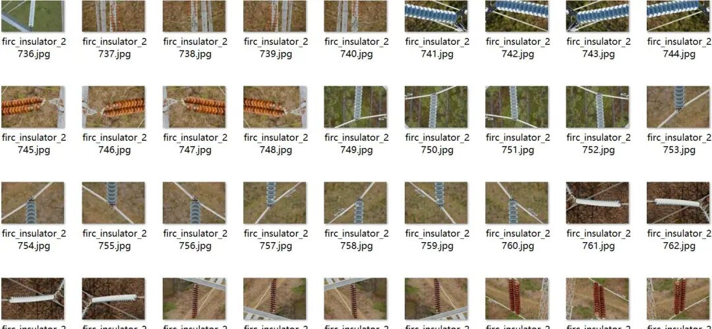
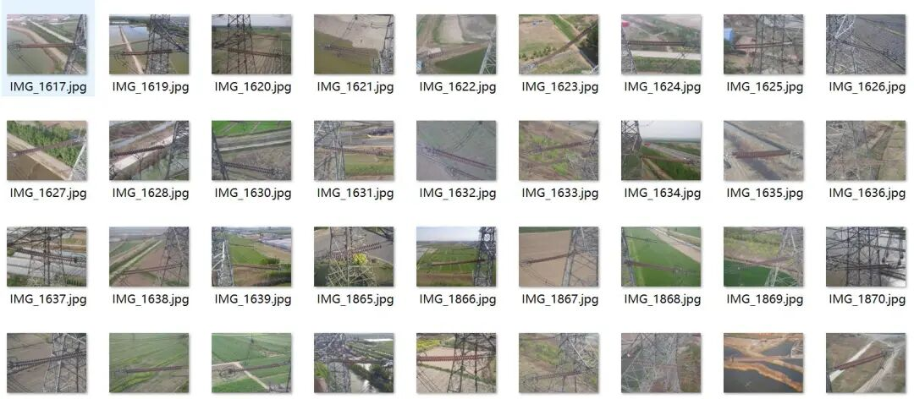
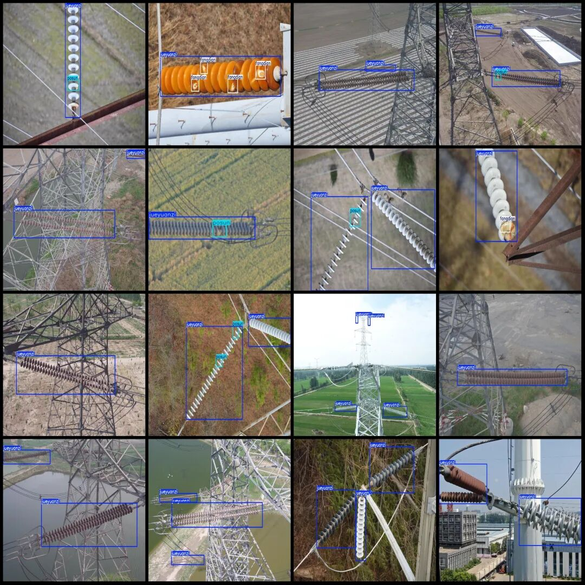
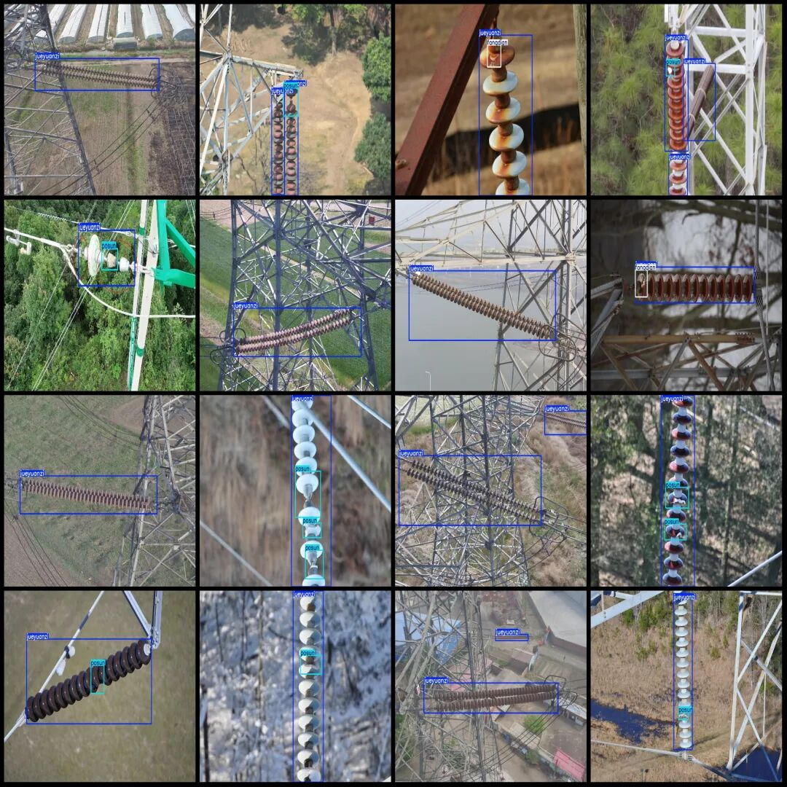

# Power Scene Insulator Defect Detection Dataset VOC+YOLO format with 4086 images in 3 categories

Dataset format: Pascal VOC format + YOLO format (txt file without split path, only containing jpg images and corresponding VOC format xml files and yolo format txt files)

Number of images (number of jpg files): 4086

Number of annotations (number of xml files): 4086

Number of annotations (number of txt files): 4086

Label category count: 3

Label category names (Note that the order of categories in the YOLO format does not correspond to this, but is based on the labels folder's classes.txt): ["fangdian", "jueyuanzi", "posun"]

Number of boxes labeled in each category:

Fangdian (discharge) frame count = 1144

jueyuanzi (insulator) frame count = 7514

Posun (broken) frame count = 1780

Total frame count: 10438

Number of images per category:

Fangdian's possession of images = 673

Jueyuanzi's possession of images = 4085

Posun's number of images = 1526

Image resolution: Multi-resolution images, such as 1280x854, 1152x864, etc.

Using labelImg:

Annotation rules: Draw a rectangle around the category.

Important Notice: The dataset does not have separate training, validation, and test sets; you need to partition them yourself.

Special : This dataset does not guarantee the accuracy of the trained models or weight files.

Image Preview:

Annotation example:

## Payment

Here is a pay link on Stripe ( https://buy.stripe.com/3cs8yP7sY87d0vu9AB ). Please contact me lonlonago@foxmail.com after funding $89, and I will send you a complete data files , thank you!

